# Campus Register

**Attendance tied to a person, a place in three dimensions and a time.**

Campus Register is a Flutter proof of concept for universities and schools. A
student can sign in to a class only if their own phone is inside the classroom's
*volume* (its outline on the map and its height above ground), during the
scheduled class, and after a fingerprint or face match. It uses the sensors of an
ordinary phone and needs no equipment in the room.

This repository accompanies an academic paper. This document explains the problem,
the method, what has been tested and what remains unproven.

| Student, outside | Student, inside | Checked in | Classroom volume | Field test |
|---|---|---|---|---|
| 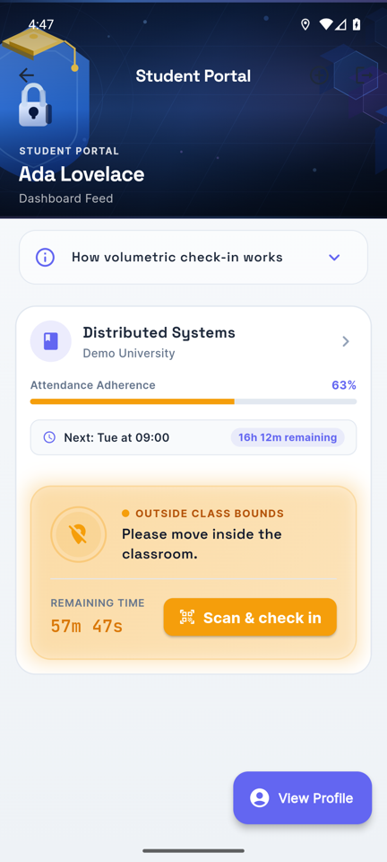 | 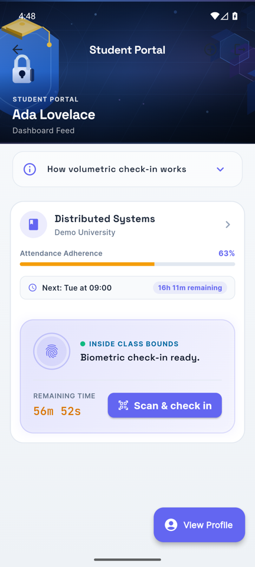 | 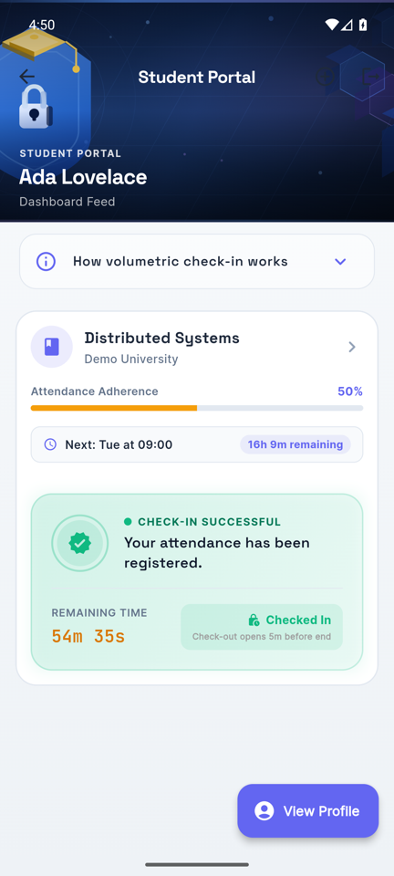 | 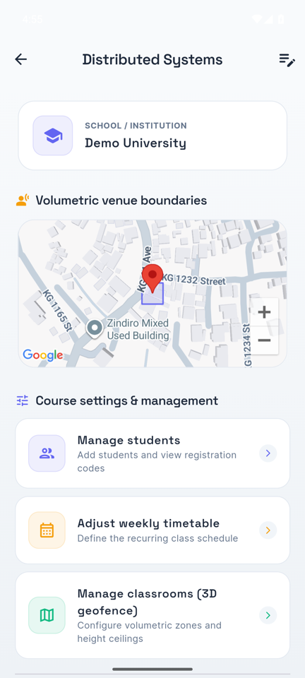 | 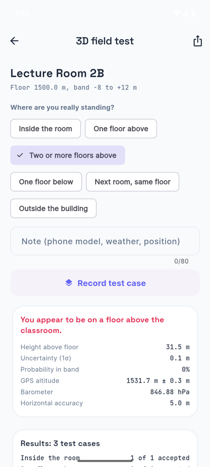 |

| Onboarding | Role selection | Teacher | Administrator | Venues |
|---|---|---|---|---|
| 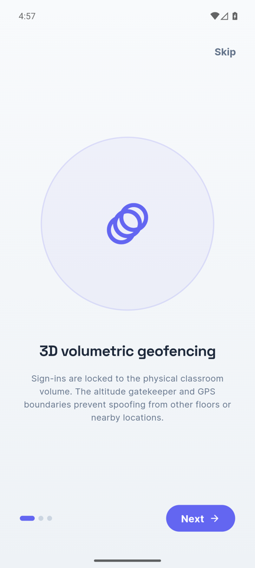 | 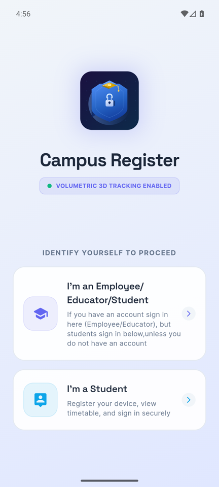 | 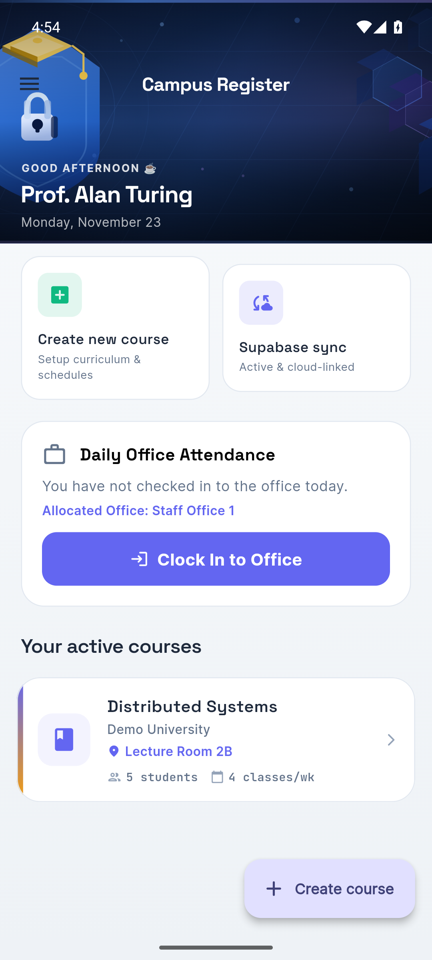 | 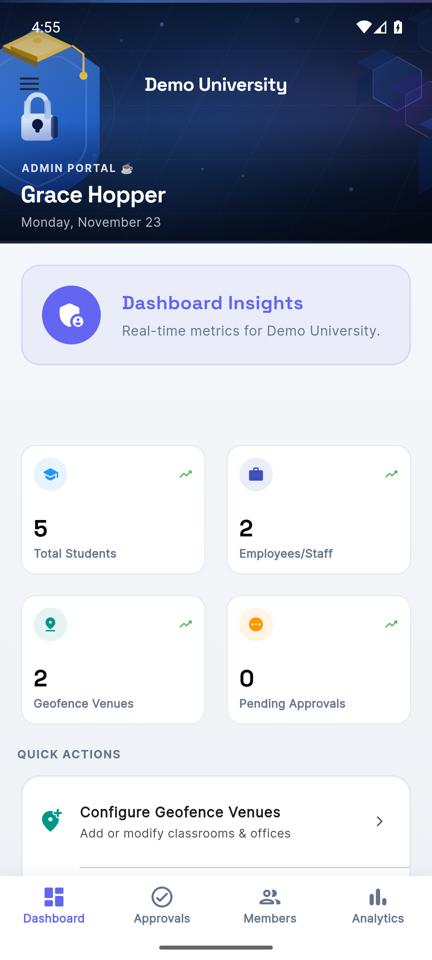 | 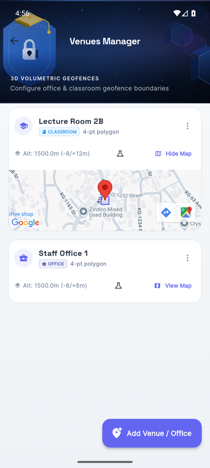 |

*Screens from an emulator with demonstration data, not real students.*

## Contents

1. [The problem](#1-the-problem)
2. [Contributions](#2-contributions)
3. [What the application does](#3-what-the-application-does)
4. [3D volumetric verification](#4-3d-volumetric-verification)
5. [Identity and device binding](#5-identity-and-device-binding)
6. [Architecture](#6-architecture)
7. [Evaluation](#7-evaluation)
8. [Field test protocol](#8-field-test-protocol)
9. [Threat model](#9-threat-model)
10. [Privacy and ethics](#10-privacy-and-ethics)
11. [Limitations](#11-limitations)
12. [Reproducing this work](#12-reproducing-this-work)
13. [Repository guide](#13-repository-guide)

## 1. The problem

Attendance records support grading, funding, visa compliance and student welfare.
They must answer a factual question: *was this person in this room during this
class?* Common methods answer a weaker one.

| Method | What it actually proves | Typical failure |
|---|---|---|
| Paper register | Someone wrote a name | One student signs for others |
| Roll call | Someone answered | Costs teaching time, does not scale |
| QR code or PIN | Someone obtained the code | The code is forwarded |
| ID card | The card was present | Cards are lent |
| Fingerprint terminal | The person was present | Hardware cost, queues, central biometric store |
| GPS check-in app | A phone reported nearby coordinates | **Works from any floor**, or for a borrowed phone |

The last row matters most here. A multi-storey building places many rooms at the
same latitude and longitude. A two-dimensional geofence cannot tell a lecture on
the second floor from the cafeteria beneath it. Four problems must be solved
together:

- **The vertical problem.** Location checks ignore height, yet phone altitude is
  noisy, so a naive height check produces wrong answers.
- **Proxy attendance.** Location identifies a phone, not a person.
- **Unreliable connectivity.** Sign-in must work without a network, and records
  must reach the server later without loss, duplication or mix-up.
- **Unmeasured accuracy.** A system that claims to prevent fraud should report how
  often it wrongly accepts or rejects.

## 2. Contributions

1. **A volumetric geofence**: a polygon with a height band, in which altitude is
   a probability judged against its own uncertainty.
2. **GPS and barometer fusion** on the phone with a Kalman filter, using each
   sensor where it is strong.
3. **One fail-closed verifier** shared by student check-in, student check-out,
   staff clock-in and starting a class.
4. **A built-in field-test instrument** that records labelled test cases and
   exports the evidence behind every decision.
5. **Reproducible tests and a floor-separation simulation** that state openly
   where altitude works and where it does not.

## 3. What the application does

| Role | Main functions |
|---|---|
| Student | Register a phone with a one-time code, check in and out, timetable, history |
| Teacher | Courses, students, venues, timetable, live attendance, reports, office clock-in |
| Administrator | Approvals, members, venues, working hours, analytics, export |

Attendance is marked *present* within five minutes of the start of class and
*late* afterwards. Check-out opens five minutes before the end. Records are kept
in SQLite, synchronised with Supabase and optionally sent to a Google Sheet.

## 4. 3D volumetric verification

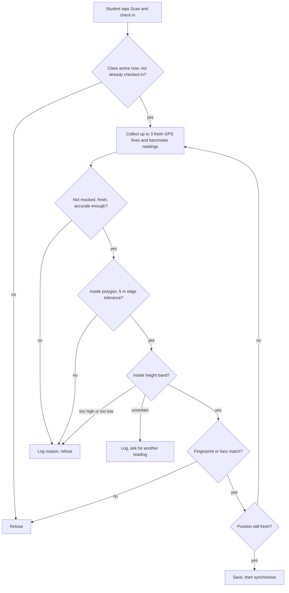

### 4.1 Horizontal check

The room is a polygon with at least three corners. Containment uses ray casting.
A point up to 5 m outside the nearest wall is accepted, to absorb lateral GPS
error. The horizontal accuracy reported by the phone must be 35 m or better.

### 4.2 Vertical check

**Fusing altitude.** The two sensors fail in opposite ways. GPS altitude is
absolute but noisy. The barometer resolves small height changes, but its absolute
value drifts with the weather. A one-dimensional Kalman filter lets pressure
*changes* predict altitude changes while GPS corrects the level:

- prediction: `z ← z + h(p_now) − h(p_previous)`, where
  `h(p) = 44330 · (1 − (p / 1013.25)^(1/5.255))`
- process noise: 3 m after one hour with a barometer; 0.5 m per √s without one
- correction: `K = P / (P + R)`, `z ← z + K (z_gps − z)`

Because consecutive GPS fixes share the same satellites and reflections, repeated
fixes are not allowed to reduce the uncertainty below half that of a single fix.
A contradictory fix (beyond 5σ) or a ten-minute gap restarts the filter. A phone
without a barometer uses the same filter with GPS alone.

**Deciding.** Let *h* be the height above the room's captured floor, *σ* its
uncertainty and the band *[−b, +a]*. The probability of being in the band is
`P = Φ((a − h)/σ) − Φ((−b − h)/σ)`.

| Condition | Decision |
|---|---|
| *P* ≥ 0.5 | `inside` |
| *P* ≤ 0.1 and above the band | `tooHigh` |
| *P* ≤ 0.1 and below the band | `tooLow` |
| otherwise | `altitudeUncertain`: ask for another reading |
| no altitude from this attempt | `noAltitude`: refuse |

The default band is −8 m to +12 m. The tolerance is set for each venue between 2 m
and 20 m, and the lower limit is the same value up to 8 m. A new venue cannot be
saved until its floor altitude has been captured on site.

### 4.3 Evidence rules

Mocked locations, fixes older than 30 s or from the future, unknown accuracy and
missing venues are all refused. Missing data never skips the check.

## 5. Identity and device binding

- A staff member issues a six-digit code, which is replaced by the phone's
  identifier when it is used.
- On Android the identifier is `ANDROID_ID`, unique to the phone, the user and the
  app's signing key. On iOS it is `identifierForVendor`.
- A phone may hold several course profiles of one student. It refuses a second
  student.
- Staff can release a lost phone, which issues a new code. The old phone loses
  access the next time it is online.
- The fingerprint or face match is done by the operating system. A PIN is not
  accepted, because it can be shared.

## 6. Architecture

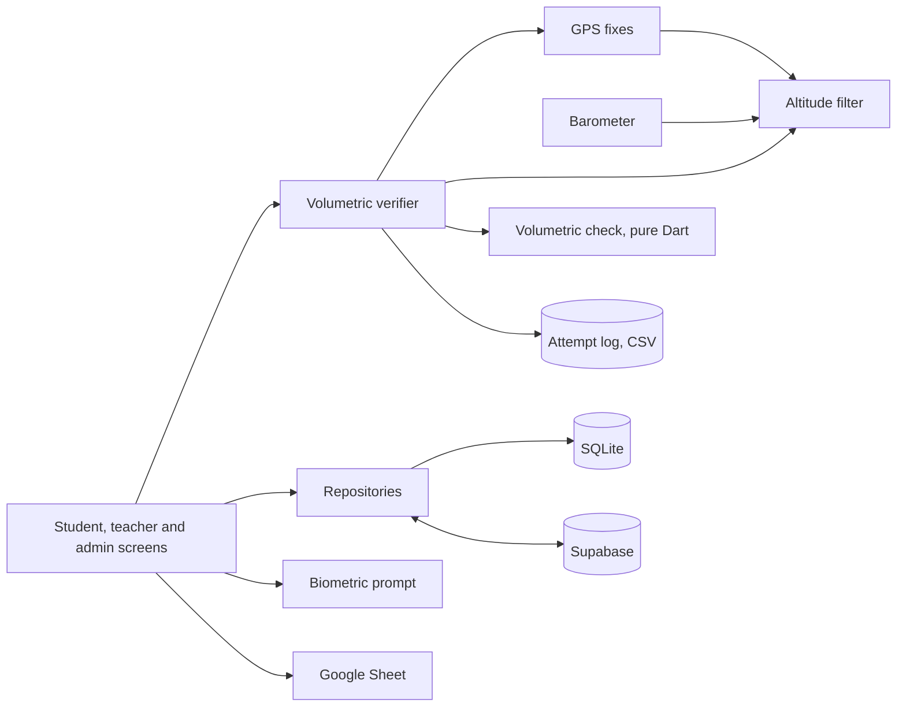

**Offline safety.** A record made offline receives a negative local identifier,
so it can never be confused with a server row. When the connection returns it is
uploaded in order, after checking whether an earlier upload already arrived.

## 7. Evaluation

### 7.1 Automated tests

68 tests pass and the static analyser reports no issues.

| Group | Cases | Examples |
|---|---:|---|
| H01–H12 horizontal | 12 | Walls, corners, next room, L-shaped room, high latitude |
| V01–V12 vertical, default band | 12 | Same floor, several floors up and down, poor altitude |
| T01–T05 vertical, tight band | 5 | One floor up and down, GPS against barometer |
| Q01–Q11 evidence quality | 11 | Mocked, stale, inaccurate, no altitude, no venue |
| B01–B03, P01–P03 | 6 | Band arithmetic, probability, barometric formula |
| F01–F13 altitude filter | 13 | Climb by barometer, weather offset, gaps, faulty sensors |
| S01–S07 offline records | 7 | Lost replies, ordering, no cross-record updates |
| L01 and interface | 2 | Attempt log, role selection |

`V11` and `V12` are deliberate: they document that the default band *accepts* the
next floors up.

### 7.2 Functional test on a device image

A debug build ran on an Android 16 (API 36) emulator with no database connection,
controlled GPS, altitude and pressure, and an enrolled emulator fingerprint.

| Case | Expected | Observed |
|---|---|---|
| Check-in, correct room and height | Prompt, then accept | Accepted; altitude 1500.0 m stored |
| Check-in 30 m higher | Refuse | `tooHigh`, estimated +31.7 m, no prompt, no record |
| Check-in 30 m north | Refuse | `outsideBoundary`, no prompt, no record |
| Check-out 30 m higher | Refuse | Refused as too high |
| Check-out, correct place | Accept | Accepted |
| Field test, 3.5 m higher | Measure | Estimated +3.8 m; accepted under the wide band |
| Field test, 30 m lower | Refuse | `tooLow`, estimated −31.6 m |

The emulator's altitude is nearly noise-free, so this verifies the logic and
integration, **not** real-world accuracy.

One observation affects experiments. When GPS altitude jumped by 40 m while
pressure stayed constant, the fused location provider kept the old altitude. On
some phones the operating system may already fuse pressure, so the two inputs to
our filter are not necessarily independent.

### 7.3 Can altitude separate floors? (simulation)

Share of attempts accepted, 20 000 trials per cell, seed 20260629. Storeys are
3.5 m. GPS altitude error is a constant bias per place plus jitter, and the room's
captured altitude has a 1.5 m error. "Barometer" means the app was open outdoors
(3 m GPS error), then the student walked in and waited, three minutes in total.

**Default band, −8 m to +12 m**

| Altitude source | −1 | Same floor | +1 | +2 | +3 | +5 |
|---|---:|---:|---:|---:|---:|---:|
| GPS only, 4 m | 85.5% | 96.3% | 97.1% | 87.2% | 63.9% | 10.2% |
| GPS only, 10 m | 60.7% | 66.1% | 67.0% | 61.4% | 52.0% | 29.2% |
| GPS 10 m + barometer | 90.9% | 99.2% | 99.4% | 93.5% | 66.9% | 5.1% |

**Tight band, −2 m to +2 m**

| Altitude source | −1 | Same floor | +1 | +2 | +3 | +5 |
|---|---:|---:|---:|---:|---:|---:|
| GPS only, 4 m | 22.1% | 29.9% | 21.9% | 8.6% | 1.8% | 0.0% |
| GPS only, 10 m | 0.0% | 0.0% | 0.0% | 0.0% | 0.0% | 0.0% |
| GPS 10 m + barometer | 26.5% | 43.8% | 26.2% | 6.0% | 0.6% | 0.0% |

**Reading the result.**

- With the wide band, the barometer raises acceptance of genuine students from
  66.1% to 99.2% when indoor GPS is poor, and lowers acceptance five floors up
  from 29.2% to 5.1%.
- **Adjacent floors are not separated.** No tested configuration accepts most
  genuine students while refusing the next floor. The residual error is the GPS
  level that anchors both the student and the room.
- Altitude is therefore useful today against *distant* floors. Separating
  *neighbouring* floors needs a shared pressure reference in the room, such as the
  teacher's phone, so that the weather and the anchor error cancel.

## 8. Field test protocol

Open **Venues Manager → flask icon** on a venue. The tester chooses where they
really are, the app decides independently, and both are logged. No attendance is
created. The result can be exported as CSV.

Suggested minimum design:

1. Capture the floor altitude once, and keep it for the whole study.
2. Use at least three phone models, including one without a barometer.
3. Record at least 20 cases for each position: inside, one floor above, two or more
   above, one below, next room, outdoors.
4. Repeat on at least three days, because pressure changes with the weather.
5. Repeat with the tolerance at 12, 6 and 3 m.
6. Report false acceptance and false rejection for each position with confidence
   intervals, separating `altitudeUncertain` from refusals.

| Column | Use |
|---|---|
| `expected`, `decision` | Confusion matrix |
| `height_m`, `sigma_m`, `probability` | Error distribution and calibration of σ |
| `gps_altitude_m`, `pressure_hpa`, `barometer_used` | Contribution of each sensor |
| `horizontal_accuracy_m` | Relation between reception and outcome |

## 9. Threat model

The adversary is a student with an ordinary phone. Rooted phones are out of scope.

| Attack | Response | Residual risk |
|---|---|---|
| Signing in from outside | Polygon, accuracy limit, fresh fix | 5 m tolerance plus GPS error |
| Signing in from another floor | Height band | Adjacent floors, section 7.3 |
| Fake-location app | Operating system mock flag | Can be hidden on a rooted phone |
| Friend uses the absent student's phone | Biometric only | Succeeds if the friend's finger is enrolled on it |
| One phone for two students | Refused at registration | Two students with identical names |
| Leaving after check-in | Check-out is verified in 3D | Presence in between is not observed |
| Changing the clock | Fix time must match the device clock within 30 s | A rooted phone can fake both |
| Guessing a registration code | Code stops working once used | Six digits, with no rate limit in the app |
| Writing to the database directly | Depends on Supabase row-level security | **Not audited in this work** |

## 10. Privacy and ethics

- Biometric data never leaves the operating system.
- Location is read while the app is in use. There is no background tracking.
- The attempt log holds no coordinates or student names and stays on the phone
  until it is exported.
- **Attendance records do contain coordinates** and are sent to Supabase and, if
  configured, a Google Sheet. A study should minimise these, set a retention period
  and obtain ethics approval and informed consent.
- An alternative must exist for students who cannot use biometrics. Teachers can
  record attendance manually.

## 11. Limitations

1. Altitude cannot yet separate adjacent floors reliably.
2. No measurements on physical phones are reported yet.
3. Android reports height above the ellipsoid and iOS above mean sea level. A venue
   must be captured and used on the same platform.
4. A new fingerprint enrolled on a phone is accepted. Invalidation of keys on new
   enrolment is planned.
5. Verification runs on the phone, and the server does not attest to it.
6. Check-out is available until the class ends. The intended extra five minutes
   after the end are not reachable from the dashboard.
7. Offline records are uploaded when the student next opens the dashboard.
8. iOS was not built or tested. The web folder is scaffolding.

## 12. Reproducing this work

Verified with Flutter 3.47.9 and Dart 3.13.7.

```bash
flutter pub get
flutter analyze
flutter test
dart run tool/floor_simulation.dart   # regenerates section 7.3
flutter run
```

To run without contacting the project's database:

```bash
flutter run --dart-define=SUPABASE_URL=http://127.0.0.1:9 --dart-define=SUPABASE_KEY=none
```

Developer sign-in shortcuts skip authentication. They exist only in debug builds
made with `--dart-define=DEV_BYPASS=true`.

## 13. Repository guide

| Path | Purpose |
|---|---|
| `lib/domain/` | Altitude filter and volumetric check, pure Dart |
| `lib/services/volumetric_verifier.dart` | Sensor collection and the single enforcement point |
| `lib/services/attempt_log.dart` | Evidence log |
| `lib/volumetric_field_test_screen.dart` | Field-test instrument |
| `lib/*_screen.dart`, `lib/ui/` | Student, teacher and administrator interfaces |
| `lib/*_repository.dart` | SQLite and Supabase data access |
| `test/` | Automated test cases |
| `tool/` | Floor-separation simulation |

Further reading: [technical documentation](TECHNICAL_DOCUMENTATION.md),
[security model](security_model.md), [product overview](about.md).

### Defects corrected in this version

| Defect | Consequence | Correction |
|---|---|---|
| Android build number used as the device identifier | Phones of the same model and OS version shared profiles, and system updates locked students out | `ANDROID_ID` |
| Developer bypass present in every build | Anyone could enter as any student, teacher or administrator | Debug builds with an explicit flag only |
| 3D check skipped when a venue failed to load | Sign-in from anywhere | Fails closed |
| No height check at check-out, clock-in or class start | Two-dimensional check only | Shared verifier |
| Barometer read but ignored | Altitude was GPS only | Kalman fusion |
| Altitude compared without its uncertainty | Arbitrary decisions near limits | Probabilistic band |
| Venue altitude defaulted to 1500 m | Meaningless height check | On-site capture required |
| PIN accepted instead of a biometric | Sign-in by anyone who knew the PIN | Biometric only |
| Mocked and stale positions accepted | Simple spoofing | Explicit rules |
| Offline records used ordinary identifiers | A check-out could update another student's record | Negative local identifiers |
| Offline records never uploaded | Lost attendance | Ordered, duplicate-safe upload |
| Whole numbers from the server rejected | Stored records treated as failures and duplicated | Numeric conversion |
| Renaming a student cleared organisation and approval | Student locked out | Fields preserved |
| Google redirect treated as success | Failures reported as success | Response checked |
| One phone accepted several students | Proxy attendance | Refused at registration |
| Old last-known position trusted | Wrong inside or outside status | One-minute limit |
| Test suite did not compile | No verification | 68 passing tests |
