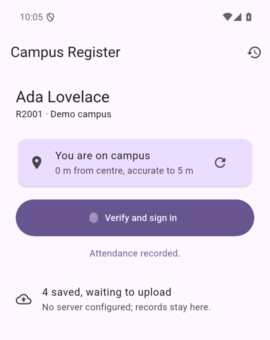
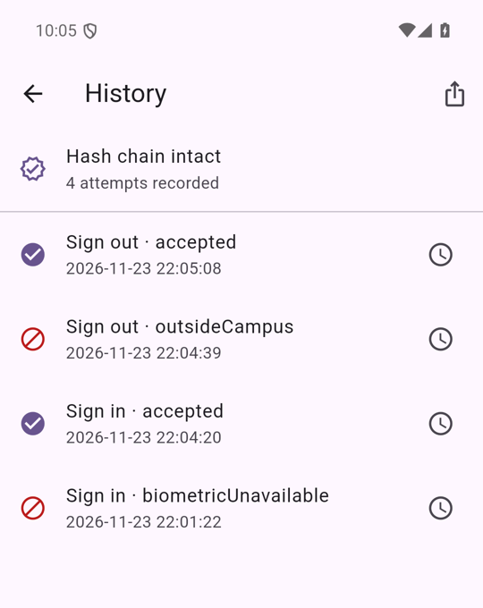
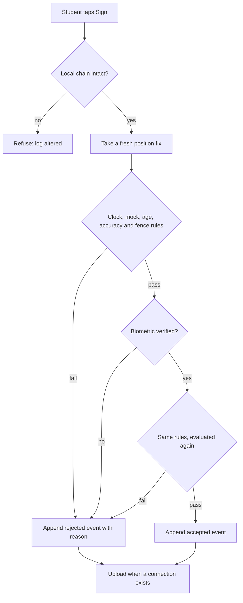
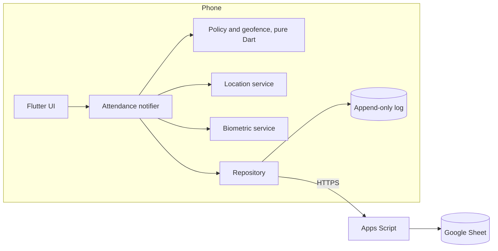

# Campus Register

**A proof of concept for presence-assured attendance on ordinary smartphones.**

Campus Register is a Flutter application that records a student's attendance
only when three independent conditions hold at the moment of signing: the phone
is on campus, the phone's enrolled user is present, and the device clock is
consistent. Every attempt, accepted or rejected, is written to a tamper-evident
log that works without a network connection.

This repository is the artefact accompanying an academic paper. This document
states the problem, the design and its rationale, what has and has not been
evaluated, and how to reproduce the results.

| Dashboard | History |
|---|---|
|  |  |

## Contents

1. [The problem](#1-the-problem)
2. [Aim and contributions](#2-aim-and-contributions)
3. [How an attempt is decided](#3-how-an-attempt-is-decided)
4. [Design](#4-design)
5. [Threat model](#5-threat-model)
6. [Evaluation](#6-evaluation)
7. [Privacy and ethics](#7-privacy-and-ethics)
8. [Limitations](#8-limitations)
9. [Reproducing this work](#9-reproducing-this-work)
10. [Repository guide](#10-repository-guide)

## 1. The problem

Universities use attendance records for assessment, funding, visa compliance and
student support. The record therefore has to answer a factual question: *was
this person in this place at this time?* Common methods answer a weaker one.

| Method | What it actually proves | Typical failure |
|---|---|---|
| Paper register | Someone wrote a name | One student signs for others |
| Roll call | Someone answered | Costs teaching time; does not scale |
| QR code or PIN | Someone obtained the code | The code is forwarded by message |
| RFID or ID card | The card was present | Cards are lent |
| Fingerprint terminal | The person was present | Hardware cost, queues, central storage of biometrics |
| GPS check-in app | A phone reported a nearby position | Poor fixes are trusted; phones are shared; locations are mocked |

Four difficulties recur when a phone is used instead of dedicated hardware:

- **Proxy attendance.** Location alone identifies a phone, not a person.
- **Uncertain position.** A position fix is an estimate with an error radius,
  often tens of metres indoors. Comparing only its centre with a boundary turns
  measurement error into wrong decisions in both directions.
- **Unreliable connectivity.** A system that needs the network when a student
  signs loses records or excludes students where coverage is poor.
- **Editable records.** A file on a student's own phone can be changed by that
  student, so a local record is not evidence unless changes can be detected.

## 2. Aim and contributions

**Aim.** Determine whether commodity phones, with no additional campus hardware
and no central biometric store, can produce attendance records whose individual
decisions are explainable and whose later alteration is detectable.

The artefact contributes:

1. **A three-valued geofence.** A fix is *inside*, *outside* or *uncertain*. The
   system declines to decide when the reported error radius crosses the boundary.
2. **A fail-closed decision procedure** that combines position, biometric and
   clock evidence and re-checks that the position is fresh after the biometric
   prompt, closing a check-then-use gap.
3. **An offline-first, hash-chained log** whose server independently recomputes
   each hash and rejects gaps and rewritten history.
4. **Instrumentation.** Rejections, distances, accuracies and stage timings are
   logged and exportable, so error rates can be measured in a field study.
5. **A reproducible simulation** of the geofence trade-off.

## 3. How an attempt is decided



Let *d* be the great-circle distance from the fix to the campus reference point,
*a* the accuracy radius reported by the operating system and *R* the fence
radius. Then:

- **inside** if *d + a ≤ R*
- **outside** if *d − a > R*
- **uncertain** otherwise

Rules are applied in this order, and the first that fails is recorded:

| # | Rule | Recorded decision |
|---:|---|---|
| 1 | Clock is not earlier than the last logged event (5 s tolerance) | `clockInconsistent` |
| 2 | A finite position is available | `noPosition` |
| 3 | The operating system does not flag the fix as mocked | `mockedPosition` |
| 4 | The fix is at most 30 s old | `staleFix` |
| 5 | The fix is not more than 30 s in the future | `clockInconsistent` |
| 6 | Accuracy is known | `poorAccuracy` |
| 7 | The fix is not wholly outside the fence | `outsideCampus` |
| 8 | Accuracy is at most 50 m | `poorAccuracy` |
| 9 | The fix is wholly inside the fence | `boundaryUncertain` |
| 10 | A biometric, not a PIN, is verified | `biometricFailed`, `biometricUnavailable` |

Rule 7 precedes rule 8 so that a coarse fix several kilometres away is reported
as off campus rather than as a weak signal. After rule 10 succeeds, rules 1 to 9
run again, because a prompt can be left open while the user walks away. The fix
itself is not retaken, so the re-check bounds its age rather than detecting
movement within the 30 s window.

The rules are a pure function with no plugin dependency
([`attendance_policy.dart`](lib/domain/attendance_policy.dart)), so each can be
tested exactly and the geofence code is the same code the simulation runs.

## 4. Design



**Tamper evidence.** Event *n* stores
`hash(n) = SHA-256(JSON array of its fields, including hash(n−1))`. The first
event points to 64 zeros. Editing, deleting or reordering an entry breaks a link.
A chain alone cannot stop someone who recomputes *all* later hashes, so the
server keeps the hashes it has already accepted: rewriting an uploaded event is
then rejected as `history rewritten`, and withholding one as `chain gap`.

**Offline first.** A decision is flushed to local storage before any network
request. Events upload in order and the only mutable sync state is a counter.
A lost reply causes a retry, which the server treats as a harmless duplicate. A
write cut short by a crash is removed on the next start. A log damaged in any
other way stops signing instead of being silently repaired.

**Device binding.** Enrolment creates a random 128-bit installation identifier.
It is not derived from hardware and cannot track a phone across applications.
Re-enrolment needs the app's data to be cleared, which starts a new chain that is
visible on the server as a second device for the same student.

**Biometrics.** Matching is done by the operating system. The application
receives only a success or failure result, and never a template or image. PIN
fallback is disabled because a PIN can be shared.

## 5. Threat model

The adversary is a student with an ordinary phone who wants a false record.
Rooted or modified devices are out of scope.

| Attack | Response | Residual risk |
|---|---|---|
| Friend signs on own phone | One enrolment per installation | A friend can install the app under another name unless staff review new devices |
| Friend signs on the absent student's phone | Biometric-only check | Succeeds if the friend's finger is enrolled on that phone |
| Signing from outside | Fresh fix, uncertainty-aware fence | Residual false accepts; see section 6 |
| Mock-location application | OS mock flag | Flag can be hidden on rooted phones |
| Signing, then leaving | Sign-out requires presence | Presence between the two is not observed |
| Changing the clock | Log order and fix time | A consistent spoof of both needs a rooted phone or radio-level attack |
| Editing the log | Hash chain and server check | Entries not yet uploaded can be rewritten as a whole chain |
| Forging uploads | Shared token | The token can be extracted from the app; events are not signed by the device |
| Reinstalling to erase rejections | New device identifier and chain | Detectable only by reviewing devices per student |

## 6. Evaluation

### 6.1 What has been verified

- **Automated tests: 34, all passing.** They cover every policy rule and its
  boundaries, chain tampering and deletion, torn writes, offline retry and
  ordering, CSV safety, enrolment consent and the complete signing flow. One test
  runs the real server script under Node.js against hashes produced by the app.
- **Functional check on an Android 16 (API 36) emulator** using a release build,
  with simulated GNSS and an enrolled emulator fingerprint. Observed: no accepted
  record without an enrolled biometric; a wrong finger did not complete the
  prompt; a correct finger was accepted; an attempt 3 km away was rejected;
  sign-out, persistence across an upgrade, chain verification and CSV export
  worked.

### 6.2 Geofence simulation

The simulation compares the usual *naive* rule (*d ≤ R*) with the three-valued
*aware* rule. Horizontal error is isotropic Gaussian and the phone reports its
68% radius, the confidence level Android documents for location accuracy. The
last row models an over-confident phone that reports half its true error.

*R* = 100 m; 200 000 trials per cell; seed 20260206. Outside positions are
uniform over the 100–150 m ring and inside positions over the disc.

| Error (68% radius) | FAR naive | FAR aware | FRR naive | FRR aware | of which "uncertain" |
|---|---:|---:|---:|---:|---:|
| Open sky, 5 m | 2.13% | 0.16% | 2.62% | 9.88% | 9.68% |
| Urban, 15 m | 6.41% | 0.44% | 7.89% | 28.24% | 27.60% |
| Indoors, 30 m | 12.64% | 0.78% | 15.85% | 52.02% | 50.72% |
| Deep indoors, 50 m | 18.96% | 0.98% | 26.06% | 76.36% | 74.04% |
| Indoors 30 m, reported as 15 m | 12.50% | 3.74% | 15.77% | 32.32% | 26.91% |

FAR is the share of outside students accepted. FRR is the share of inside
students not accepted. "Uncertain" is expressed as a share of *all* inside
students, so it is directly comparable with FRR.

**Reading the result.** When phones report their error correctly, the aware rule keeps
false accepts below 1% at every error level, 13 to 19 times lower than the naive
rule. The cost is substantial: at 30 m error about half of the genuine students
inside the fence are not accepted on the first attempt, nearly all of them as
*uncertain* rather than *outside*. The rule therefore suits fences that are large
relative to the expected error, and deployments with a manual fallback. The
benefit also shrinks when phones under-report their error, as the last row shows.

**Validity.** This is a simulation, not field evidence. Real errors are biased
and correlated by buildings, and the 100–150 m ring is a deliberately hard case.
The naive rule could also lower its FAR by using a smaller radius; a comparison
at equal FAR remains to be done. The table tests rules 7 and 9 only.

### 6.3 Proposed field study

Not yet performed. The log already captures the data it needs.

| Question | Measure | Source |
|---|---|---|
| How accurate are decisions? | FAR and FRR against surveyed positions | `decision`, `distanceM`, `accuracyM` |
| Is reported accuracy calibrated? | Share of true positions within `accuracyM` | Surveyed points |
| What does it cost the student? | Distribution of stage times | `locationMs`, `biometricMs` |
| Is it reliable offline? | Records lost, upload delay | `timestamp`, server `receivedAt` |
| Is it usable? | Attempts per success, a standard usability scale | Log, questionnaire |

## 7. Privacy and ethics

- Raw coordinates are never stored or uploaded; only the distance from campus
  and its accuracy are.
- Location is read while the app is open and in use. There is no background
  tracking.
- Biometric data stays inside the operating system.
- Enrolment requires explicit consent and lists what is recorded.
- Android backup is disabled, so a log cannot be cloned to a second phone.

Distance from campus on a *rejected* attempt is still personal data. A study
should set a retention period, obtain ethics approval and provide an alternative
for students who cannot or do not wish to use biometrics.

## 8. Limitations

1. **The biometric proves "a user enrolled on this phone"**, not the identity of
   a named student. Enrolment is self-declared and needs supervised onboarding.
2. **Decisions are made on the client.** The server verifies consistency, not
   truth. Hardware-backed signing keys and platform attestation would be the next
   step.
3. **One circular fence** covers a campus, not a room or floor.
4. **No timetable.** Records show presence on campus, not attendance at a class.
5. **The server is a prototype.** Looking up a chain scans the sheet, which suits
   a pilot and not a whole institution.
6. **iOS is configured but has not been built or tested**, and the files in
   `web/` are scaffolding: the app needs native storage and biometrics.
7. The server script has been tested with stubbed Google services, not in a live
   deployment.

## 9. Reproducing this work

Requires a Flutter release with Dart 3.12 or later (verified with Flutter 3.47.9,
Dart 3.13.7). Node.js is
optional; without it the server test is skipped.

```bash
flutter pub get
flutter analyze
flutter test
dart run tool/geofence_simulation.dart   # regenerates the table in 6.2
```

Run on a device, with your own site:

```bash
cp config.example.json config.json       # ignored by git; edit the values
flutter run --dart-define-from-file=config.json
```

| Key | Meaning | Default |
|---|---|---|
| `CAMPUS_NAME` | Label on the dashboard | `Demo campus` |
| `CAMPUS_LAT`, `CAMPUS_LON` | Reference point, decimal degrees | Sample point |
| `CAMPUS_RADIUS_M` | Fence radius in metres | `100` |
| `MAX_ACCURACY_M` | Coarsest usable fix in metres | `50` |
| `SYNC_URL` | Apps Script `/exec` URL; empty keeps data on the phone | empty |
| `SYNC_TOKEN` | Must equal the server's script property | empty |

To collect centrally, create a Google Sheet, paste
[`server/Code.gs`](server/Code.gs) into *Extensions → Apps Script*, add a script
property `SYNC_TOKEN`, and deploy it as a web app that executes as you and is
accessible to anyone.

## 10. Repository guide

| Path | Purpose |
|---|---|
| `lib/domain/` | Geofence and policy; pure Dart |
| `lib/data/` | Event model, hash chain, storage, sync, CSV |
| `lib/services/` | Location and biometric adapters |
| `lib/providers/` | Orchestration of an attempt |
| `lib/ui/` | Enrolment, dashboard, history |
| `server/` | Collection endpoint and its test harness |
| `tool/` | Geofence simulation |
| `test/` | Automated tests |

### Defects corrected in version 2.0

| Defect in the original scaffold | Consequence | Correction |
|---|---|---|
| Android activity was not a `FragmentActivity` | The biometric prompt could not open, so nobody could sign | `FlutterFragmentActivity`, AppCompat theme, permission |
| Position was checked at launch, not at signing | A student could leave and then sign | Fresh fix and re-evaluation on every attempt |
| Reported accuracy was ignored | Very coarse fixes were trusted | Three-valued fence and accuracy limit |
| Mocked and stale fixes were accepted | Trivial spoofing | Explicit rules |
| Google's 302 reply was treated as a failure | Every upload appeared to fail | Redirect followed; response body checked |
| Failed uploads were never retried | Lost records | Durable ordered queue |
| A failed upload left the button active | Duplicate records | Local state is authoritative |
| `lat,lon` was written unquoted to CSV | Five values under four headings | Quoted export with formula protection |
| Errors could not be cleared from state | Old errors shown after success | State rebuilt from its source |
| Student name was hardcoded | One possible user | Enrolment |
| Signing out was impossible | Incomplete record | Alternating sign-in and sign-out |
| The only test was for a different app | It always failed | 34 relevant tests |

### Relation to the full application

A larger version, with timetables, polygon venues, staff roles and a Supabase
backend, is preserved in this repository's history at commit `6e9e13b`. This
branch isolates the attendance-assurance mechanism so that it can be examined and
reproduced on its own.
