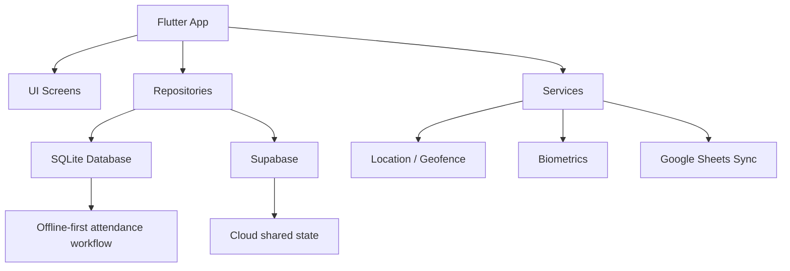
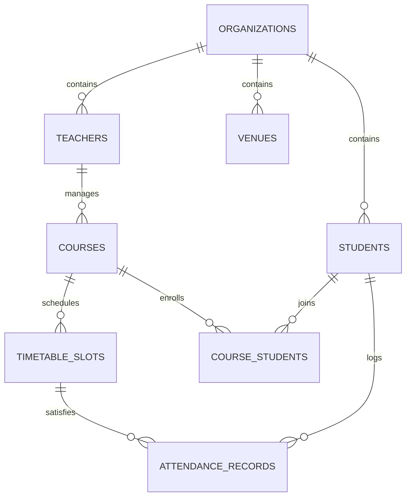

# Campus Register — Comprehensive Product and Technical Documentation

## 1. What this app is

Campus Register is a Flutter-based attendance platform for schools and institutions. It is built around a simple but powerful idea: attendance should be tied to a real place, a real time window, and a real person.

The app is designed to reduce attendance fraud by combining:

- location-based geofencing,
- altitude/vertical validation,
- biometric authentication,
- time-window enforcement,
- offline-first local persistence,
- cloud synchronization to Supabase and Google Sheets.

In practice, this means a student can only check in when they are physically inside the assigned classroom boundary during the correct class period and after proving their identity.

---

## 2. Product overview

### Core roles

- Student: checks in to class, views attendance history, and sees their course timetable.
- Teacher: manages courses, students, venues, timetables, and attendance workflows.
- Admin: manages organization-wide approvals, members, analytics, and governance.

### Primary user outcomes

- secure, tamper-resistant attendance capture,
- offline support in low-connectivity environments,
- easy reporting for instructors and administrators,
- cloud backup and spreadsheet export for operational visibility.

---

## 3. High-level architecture

The app follows a hybrid architecture:

- Flutter UI layer for mobile screens and interactions.
- SQLite local database for fast, reliable offline storage.
- Supabase as the cloud data layer for shared records and cross-device sync.
- Google Sheets integration for reporting/export workflows.
- Native device APIs for biometrics, device identity, geolocation, and altitude sensing.

### Runtime model

---

## 4. Technical stack

| Layer | Technology | Purpose |
|---|---|---|
| App framework | Flutter + Dart | Cross-platform mobile UI |
| Local persistence | SQLite via sqflite | Reliable offline cache |
| Cloud backend | Supabase Flutter | Remote data sync and shared records |
| Maps | Google Maps Flutter | Venue polygon editing and geofencing context |
| Location | geolocator | GPS checks and permission handling |
| Biometrics | local_auth | Fingerprint/face verification |
| Device identity | device_info_plus | Hardware-based device binding |
| Altitude sensing | sensors_plus | Barometric pressure / altitude handling |
| HTTP integration | http | Google Sheets automation |
| Export/reporting | csv, share_plus | CSV export and sharing |
| UI visuals | lottie, flutter_svg, google_fonts | Premium dashboard experience |

---

## 5. Project structure

The app logic is centered in [lib](lib), with the following major areas:

- [lib/main.dart](lib/main.dart): app bootstrap, initialization, and initial screen selection.
- [lib/database_helper.dart](lib/database_helper.dart) and [lib/database_schema.dart](lib/database_schema.dart): database lifecycle and schema creation.
- [lib/location_service.dart](lib/location_service.dart): geolocation and polygon containment logic.
- [lib/check_in_service.dart](lib/check_in_service.dart): active class detection based on timetable data.
- [lib/services/biometric_service.dart](lib/services/biometric_service.dart): biometric authentication wrapper.
- [lib/services/altitude_service.dart](lib/services/altitude_service.dart): altitude handling and floor logic.
- [lib/student_dashboard_screen.dart](lib/student_dashboard_screen.dart): main student experience and check-in flow.
- [lib/admin_dashboard_screen.dart](lib/admin_dashboard_screen.dart): admin operations and analytics.
- [lib/attendance_repository.dart](lib/attendance_repository.dart): attendance reporting and stats.
- [lib/student_repository.dart](lib/student_repository.dart), [lib/teacher_repository.dart](lib/teacher_repository.dart), [lib/venue_repository.dart](lib/venue_repository.dart): repository layer for domain data.

---

## 6. Data model and database design

The database is intentionally relational and supports organization-level attendance operations. The core tables include:

- organizations
- timetable_constraints
- teachers
- courses
- timetable_slots
- students
- course_students
- attendance_records
- venues
- clock_logs
- attendance_waivers
- timetable_day_overrides

### Main relationships

### Why this data model matters

The design is not just for CRUD operations. It is optimized for authenticated, time-bound, venue-bound attendance validation. Every attendance record is tied to:

- a student,
- a timetable slot,
- a course,
- a venue,
- a timestamp,
- geolocation coordinates,
- altitude,
- status.

That allows the system to produce trustworthy attendance evidence rather than just a simple presence flag.

---

## 7. The secret sauce: why this app is different

The most important technical differentiator is that the app is not a simple check-in app. It is an attendance integrity system.

### 7.1 3D volumetric geofencing

The core security mechanism is implemented in [lib/location_service.dart](lib/location_service.dart).

The app validates attendance using three layers:

1. Horizontal polygon containment
   - venues are defined by polygons on a map,
   - a ray-casting algorithm checks whether the GPS point is inside the polygon,
   - this prevents check-ins from nearby rooms or adjacent buildings.

2. Lateral tolerance
   - the system allows a small 5 meter buffer around polygon edges,
   - this compensates for GPS noise and indoor signal drift.

3. Vertical validation
   - the app compares the phone’s altitude with the venue baseline,
   - sign-in is blocked if a student is too far above or below the defined room level.

This is the app’s “secret sauce”: it turns attendance from a loose location check into a 3D boundary verification process.

### 7.2 Biometric + hardware binding

The student experience does not rely on passwords. Instead, identity is tied to the device hardware ID.

The app uses:

- device_info_plus to capture a hardware identifier,
- a temporary registration code to bind a student profile to that device,
- local_auth to require a fingerprint or face unlock before attendance is finalized.

This means the identity proof is not just a username and password; it is a blend of device identity and biometric confirmation.

### 7.3 Time-window enforcement

Attendance is never open-ended. A student can only check in during an active timetable slot. The check-in logic in [lib/check_in_service.dart](lib/check_in_service.dart) looks up the current day and current time, then matches them against the course timetable.

This prevents casual or retrospective check-ins and makes attendance timestamps meaningful.

### 7.4 Offline-first resilience

The app is built to work even when connectivity is poor or absent. The repositories and database helpers are designed to:

- save attendance locally immediately,
- keep the local cache as the operational source during offline periods,
- sync to Supabase when possible,
- export to Google Sheets as a secondary reporting layer.

This is especially important in campus environments where mobile network coverage is inconsistent.

---

## 8. Core application flows

### Student flow

1. The student launches the app.
2. The app reads the device identifier and resolves the student profile.
3. If the student is linked to a course, the dashboard loads their schedule and attendance data.
4. When a timetable slot becomes active, the student can attempt check-in.
5. The app verifies:
   - the student is inside the venue boundary,
   - the altitude is acceptable,
   - the current time is inside the allowed window,
   - biometric authentication succeeds.
6. On success, the attendance record is written locally and then synchronized outward.

### Teacher flow

1. The teacher signs in and accesses the admin/teacher dashboard.
2. They create or manage courses, students, venues, and timetables.
3. They configure a venue by defining a polygon and altitude baseline.
4. They link a Google Sheet for reporting.
5. Attendance data becomes visible through the dashboard and the connected sheet.

### Admin flow

1. The admin reviews new teacher and student approvals.
2. They manage organization-level members.
3. They inspect analytics for attendance and clock log trends.
4. They can export or share data for reporting and compliance.

---

## 9. Service and repository pattern

The app uses a repository-service structure that separates domain logic from UI logic.

- Repositories manage data access and store/cache operations.
- Services handle external concerns like biometrics, location, and timing.
- Screens orchestrate the UI and call the repositories/services.

This pattern keeps the code organized and makes the app easier to extend.

### Examples

- [lib/attendance_repository.dart](lib/attendance_repository.dart): attendance reporting and organization analytics.
- [lib/student_repository.dart](lib/student_repository.dart): student lifecycle, device registration, and local/cloud sync.
- [lib/venue_repository.dart](lib/venue_repository.dart): venue upsert, lookup, and sync.
- [lib/check_in_service.dart](lib/check_in_service.dart): active slot resolution.

---

## 10. Sync strategy

The app uses a hybrid sync strategy:

### Local-first

- SQLite is the primary operational store.
- Attendance writes happen immediately.
- The app remains usable even when the network is down.

### Cloud sync

- Supabase stores shared records and allows cross-device consistency.
- Repositories try to upsert data to Supabase when online and fall back to local storage otherwise.

### Reporting export

- Google Sheets integration pushes attendance updates for downstream reporting and teacher visibility.

This is powerful because the app does not depend on always-on connectivity to be useful.

---

## 11. Security posture

The security model is stronger than a basic attendance app because it combines multiple checks rather than relying on a single signal.

### Security layers

- device identity binding,
- biometric verification,
- physical location verification,
- timing verification,
- local-first evidence storage,
- cloud backup and audit-friendly export.

The app is intentionally designed to make casual attendance abuse harder. It is not a perfect anti-cheat system, but it is significantly more robust than simple “tap to check in” apps.

---

## 12. Notable implementation details

### Database initialization and migration

The startup path in [lib/main.dart](lib/main.dart) initializes the database before deciding which screen to show. The database helper also manages schema upgrades and resets, which is important for evolving the app without corrupting the user data model.

### Device-based student identity

Students are not authenticated with a password. The app binds them to a hardware device ID, which makes sign-in more secure and more convenient in classroom deployments.

### Multi-profile support

The student dashboard can resolve multiple student profiles tied to the same device, which makes the app flexible for cases where one device is associated with multiple course-linked identities.

### Attendance analytics

The admin screens and repositories compute attendance statistics and trends directly from stored attendance data, which gives institutions a useful overview without requiring a separate backend analytics stack.

---

## 13. Setup and run notes

The app is a standard Flutter project.

### Prerequisites

- Flutter SDK 3.3+
- Android Studio or VS Code with Flutter support
- emulator or physical device

### Typical local workflow

1. Install dependencies:
   - flutter pub get
2. Run the app:
   - flutter run
3. Ensure relevant platform permissions are granted:
   - location,
   - biometrics,
   - notification-related permissions where needed.

---

## 14. Strengths of the current implementation

- strong attendance integrity model,
- offline-first and resilient,
- good separation of concerns,
- practical cloud sync strategy,
- real-world use case focus.

---

## 15. Opportunities for improvement

The current build is already functional and differentiated, but there are clear next steps:

- add server-side validation to prevent tampering at the backend layer,
- introduce signed attendance tokens for stronger auditability,
- improve sync reconciliation between local SQLite and remote Supabase,
- add more explicit conflict handling and offline queue management,
- extend biometric security with stronger hardware key enforcement,
- add richer analytics dashboards and export formats.

---

## 16. Bottom line

Campus Register is more than a class attendance tracker. It is a location-aware, time-aware, identity-aware attendance assurance system built for real-world institutional use.

Its true differentiator is the combination of:

- 3D geofencing,
- biometric verification,
- hardware binding,
- timetable locking,
- offline-first persistence,
- cloud sync and reporting.

That combination is the core of the app’s technical value and its practical “secret sauce.”
