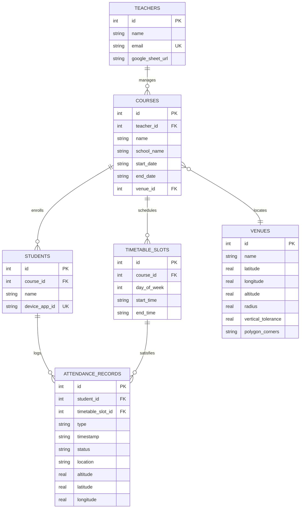

# Campus Register 📱🎓

**Campus Register** is a mobile-first, offline-ready classroom attendance management system built using Flutter. It is designed to secure academic integrity by preventing attendance fraud (e.g., location spoofing, "buddy checking") through a combination of **3D Volumetric Geofencing**, **Biometric Verification**, and **Scheduled Time-Window Locking**. It operates under an offline-first paradigm, caching data in a local SQLite database and syncing in real-time to **Supabase Postgres** and **Google Sheets**.

---

## 🌟 Key Features

### 1. 3D Volumetric Geofencing
To prevent attendance spoofing from nearby buildings or incorrect classroom floors, the system employs 3D geofencing:
*   **2D Horizontal Polygon Mapping:** Classroom boundaries are drawn as polygons on a map using Google Maps. The device's current location must fall inside this polygon (validated using a Ray-Casting algorithm).
*   **Altitude Verification (Vertical Gatekeeper):** The system records the classroom's physical floor height (altitude in meters). A student's device altitude is compared with this baseline. Sign-in is blocked if:
    *   The student is underground (`altitude < baseline - 2.0m`).
    *   The student is on a different floor (`altitude > baseline + 5.0m`).

### 2. Biometric Identity Verification
*   **Anti-Buddy Check-In:** Prevents students from signing in for absent classmates.
*   Once location and timing are verified, the app triggers the device's native fingerprint or face recognition prompt (using `local_auth`).
*   Only after a successful biometric match is the attendance record written.

### 3. Automated Time-Window Locking
*   Attendance is tied to a specific **Timetable Slot** (e.g., Monday 10:00 AM - 12:00 PM).
*   Students can only check in during active class times.
*   **Grace Period & Status Tagging:** The app automatically marks students who check in within the first 5 minutes as `PRESENT`, and anyone after that as `LATE`.

### 4. Hybrid Sync Architecture (Offline-First)
*   **Local SQLite Cache:** Saves all teacher, student, venue, and attendance data locally immediately, allowing complete offline check-ins in weak campus network environments.
*   **Supabase PostgreSQL Sync:** Connects to Supabase to store shared data online, handling cloud updates and synchronizations.
*   **Google Sheets Automation:** Automatically pushes attendance records to a teacher's configured Google Sheet in real-time for easy viewing, grading, and backup.

### 5. Premium Interactive Dashboards
*   **Student Dashboard:**
    *   **Enrolled Weekly Timetable:** Shows a horizontal, card-based weekly schedule for the student's enrolled course, highlighting today's classes with active visual borders and badges.
    *   **Active Class Live Countdown:** Automatically calculates and displays a live, real-time countdown timer showing the remaining time (hours, minutes, seconds) for an ongoing class session.
*   **Teacher Dashboard:**
    *   **Time-Aware Welcome Header:** Displays an adaptive welcoming greeting based on the current hour of the day (e.g. *Good Morning 🌤️*, *Good Afternoon ☕*, *Good Evening 🌙*) along with a formatted calendar date.
    *   **Stat/Action Cards Grid:** Quick-action shortcuts to launch the volumetric geofence editor on Google Maps or run an instant cloud database connection sync check.
    *   **Dynamic Course Analytics:** Lists active courses with gradient border designs, utilizing parallel database queries to display live stats (e.g. total enrolled students count, classes/week frequency).

---

## 🛠 Technical Stack & Architecture

*   **Frontend Framework:** Flutter (Dart)
*   **Local Database:** SQLite (via `sqflite`) for offline persistence
*   **Backend & Authentication:** Supabase (PostgreSQL & Supabase Auth)
*   **Integrations:** 
    *   Google Maps API (for polygon drawing and classroom visualizations)
    *   Google Sheets API (for spreadsheet sync automation)
    *   Device Info API (to pair student profiles securely with a unique hardware ID)
    *   Biometrics API (via `local_auth` for fingerprint validation)

---

## 🗃 Relational Database Schema

The local SQLite and remote Supabase PostgreSQL databases share a synchronized structure:

---

## 🔄 Core User Flows

### A. The Teacher Flow
1.  **Authentication:** Sign up or log in using email/password (via Supabase) or Google Sign-In.
2.  **Course Management:** Create courses and manage registered students.
3.  **Volumetric Geofence Editor:**
    *   Open Google Maps within the app.
    *   Tap on the map to define the polygon corners of the classroom.
    *   Tap **Capture Altitude** while physically in the room to record the floor's baseline altitude.
4.  **Timetable Planning:** Set scheduled classes (day of week, start/end times).
5.  **Google Sheet Linking:** Provide a Google Sheet URL where attendance will auto-populate.

### B. The Student Flow
1.  **Device Pairing:** Upon opening the app for the first time, it registers the device's hardware ID. The student provides their name and selects their enrolled course.
2.  **Dashboard Check-In:**
    *   The app periodically polls to see if there is an active class slot for their enrolled course.
    *   When active, the student taps **Scan & Check In**.
3.  **Verification Steps:**
    *   *Step 1:* Verifies device GPS is within the classroom polygon.
    *   *Step 2:* Verifies altitude matches the classroom floor height.
    *   *Step 3:* Prompts for a biometric fingerprint scan.
4.  **Completion:** The record is saved locally, synchronized with Supabase, and pushed to the teacher's Google Sheet.
