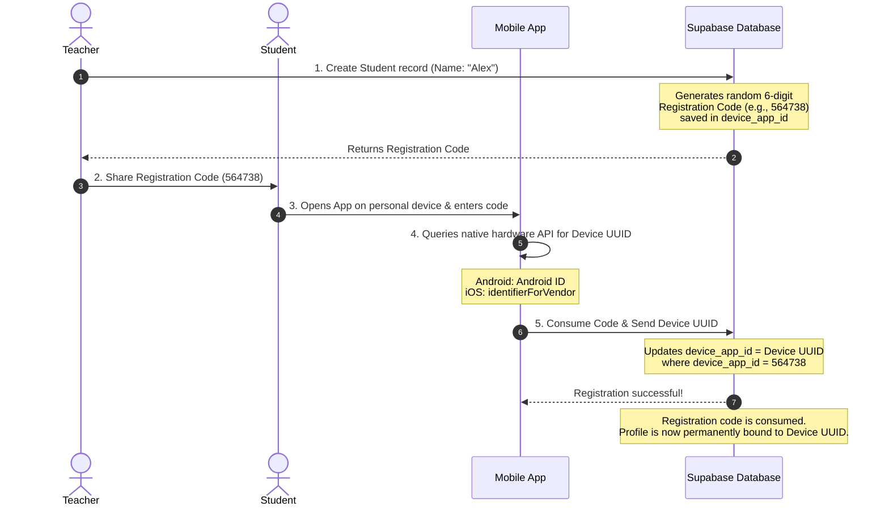

# Campus Register - Biometric & Device Binding Security Model 🔒

This document details the security architecture of the **Campus Register** application, explaining how it enforces biometric integrity, guarantees device-to-student binding, and prevents attendance fraud (e.g., logging in with another device or delegating check-ins).

---

## 🛡️ 1. How Biometric & Device Binding Works (Guaranteed 1-to-1 Pairing)

To prevent a student from checking in for another classmate (known as "buddy checking"), the application relies on a strict **1-to-1 hardware-to-profile binding** established during student registration.

### Step-by-Step Registration Security Flow

1.  **Teacher Registration Initialization:** The teacher creates the student profile on the dashboard. The system generates a single-use random 6-digit code (e.g., `564738`) and stores it temporarily in the `device_app_id` field.
2.  **Device UUID Capturing:** When the student registers, the mobile app queries the native operating system hardware API for a unique device hardware identifier:
    *   **Android:** `AndroidId` (provided via `device_info_plus` querying the Android Keystore system).
    *   **iOS:** `identifierForVendor` (a unique hardware-bound UUID generated per app vendor).
3.  **One-Time Code Consumption:** The app sends the device ID along with the registration code to Supabase. The database **overwrites** the temporary registration code in the `device_app_id` field with the device's hardware ID.

---

## 🚫 2. Preventing Logins/Check-ins on Other Devices

The application guarantees that a student **cannot** log in on another device and check in for themselves or others. Here is how that is strictly enforced:

### A. Passwordless, Hardware-Locked Authentication
There are no passwords or username fields in the student portal. The student's identity is determined **exclusively** by the device ID of the phone opening the app.
When the app launches, it reads the local hardware ID and checks if that ID matches the `device_app_id` on Supabase:
*   If a student opens the app on a **different device**, the new device will have a different hardware ID.
*   The database query for that device ID returns empty, and the app defaults to the registration/role-selection screen.
*   If the student attempts to enter their registration code again on the new device, the attempt is rejected because the 6-digit code **no longer exists** in the database (having been overwritten during initial registration).

### B. Unique Database Constraint
The database schema defines the `device_app_id` field with a `UNIQUE` constraint. This means:
*   No two student profiles can ever be bound to the same device hardware ID.
*   This prevents students from sharing a single device to check in sequentially.

---

## 🔑 3. Biometric Verification Security

When a student checks in:
1.  The app prompts the device's native biometric authentication module (`local_auth`).
2.  The verification is handled directly by the **Secure Enclave** (iOS) or **Trusted Execution Environment / Keystore** (Android).
3.  The operating system verifies that the finger pressed matches one of the fingerprints enrolled on the device.
4.  **No Spoofing:** Because the biometric check executes inside the hardware's secure enclave, the app logic only receives a secure cryptographic confirmation token (`true`/`false`). The app itself has no code pathways that can bypass this prompt.

### ❓ What if a student registers a classmate's fingerprint on their phone?
*   A phone can technically store multiple fingerprints (e.g. Owner's finger + Spouse's finger).
*   However, because the account profile is locked to the physical device ID, the student would have to **give their physical phone** to their classmate to check in.
*   To check in on that phone, the classmate would have to physically walk into the classroom to pass the **3D Volumetric Geofence** (polygon check) and the **Altitude Ceiling** (floor check).
*   Therefore, the classmate cannot check them in remotely. They would need to physically carry the absent student's phone into the classroom, rendering remote cheating impossible.

---

## 🌐 4. Volumetric Geofencing & GPS Lateral Tolerances

To prevent GPS spoofing and address hardware inaccuracies, the application enforces a 3D volumetric verification boundary with dual-plane tolerance zones.

### A. Vertical (Altitude) Gatekeeper
*   **Purpose:** Prevents students from checking in from upper floors or underground levels.
*   **Allowance Zone:** A range of **-2.0 meters to +5.0 meters** is allowed relative to the classroom's baseline altitude.
*   **Enforcement:** Prevents false check-ins if the student is standing directly above or below the classroom.

### B. Lateral (Horizontal) Allowance [NEW]
*   **Purpose:** Compensates for lateral GPS triangulation errors and multipath interference (common when indoors or surrounded by large campus structures).
*   **Allowance Zone:** A **5-meter horizontal buffer** is extruded outwards from the classroom's polygon boundary lines.
*   **Enforcement:** If a student's calculated coordinates place them slightly outside the classroom area (up to 5 meters from any wall or corner), the check-in is accepted as valid. Check-ins beyond the 5-meter limit are immediately blocked.

---

## 🔒 5. Mitigating Multi-Fingerprint Enrollment (Enrolling a Friend's Fingerprint)

If a student registers a classmate's fingerprint on their device (enrolling it in the phone's system settings), the OS's native biometric manager treats both fingerprints as the "Device Owner." However, the system mitigates and prevents this exploit through three layers of security:

### A. High Personal Friction (Device Sharing Lock)
A student’s phone contains highly sensitive personal data (banking apps, private messaging, emails, and social media accounts). 
* To exploit this loophole, the absent student **must physically surrender their phone** to their friend for the day.
* Due to privacy concerns, the friction of giving away an unlocked personal phone is extremely high, making it a very rare occurrence.
* If a classmate is caught holding or scanning two active phones during class, it is a visible physical indicator of attendance spoofing.

### B. Biometric Key Invalidation (The Cryptographic Defense)
On Android and iOS, we can generate a cryptographic key pair inside the phone's hardware **Secure Enclave / Keystore** to sign check-ins.
* When this key is generated, we set the OS attribute `setInvalidatedByBiometricEnrollment(true)` (Android) or `SecAccessControl` policies (iOS).
* If the student enrolls a new fingerprint (e.g., their friend's) in their device settings *after* the initial registration, **the phone's operating system automatically invalidates and deletes the cryptographic keys**.
* The app's check-in will immediately fail. The student will be locked out and must ask the teacher to reset their account, exposing the modification attempt.

### C. Secondary Front-Camera Verification (Optional Upgrade)
For high-stakes examinations or strict attendance policies, a front-camera verification step can be integrated:
* During biometric verification, the front camera captures a quick selfie of the user checking in.
* The photo is uploaded alongside the attendance record to Supabase or compared on-device.
* If a friend checks in the device, the face in the photo will not match the registered student's face, providing audit trails.

---

## 🛠️ 6. Device Recovery (If a student loses their phone)

If a student gets a new phone or loses their device, they cannot register the new device themselves because their code is already consumed.

1.  The student must report the device change to the teacher.
2.  The teacher opens the student management portal.
3.  The teacher resets the student's device binding.
4.  The system clears the `device_app_id` on Supabase and generates a **new single-use registration code** for the student's new device.
